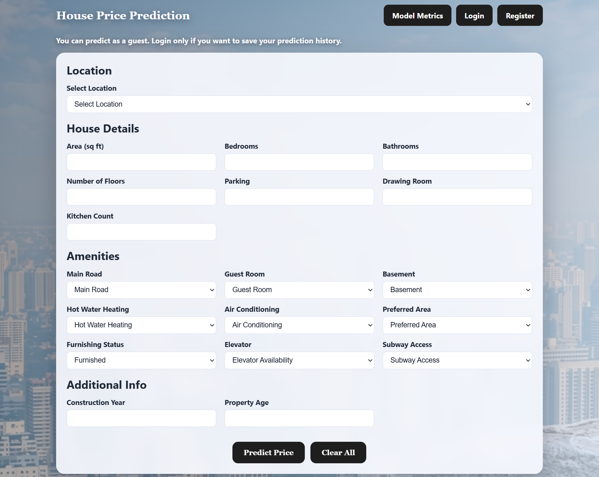
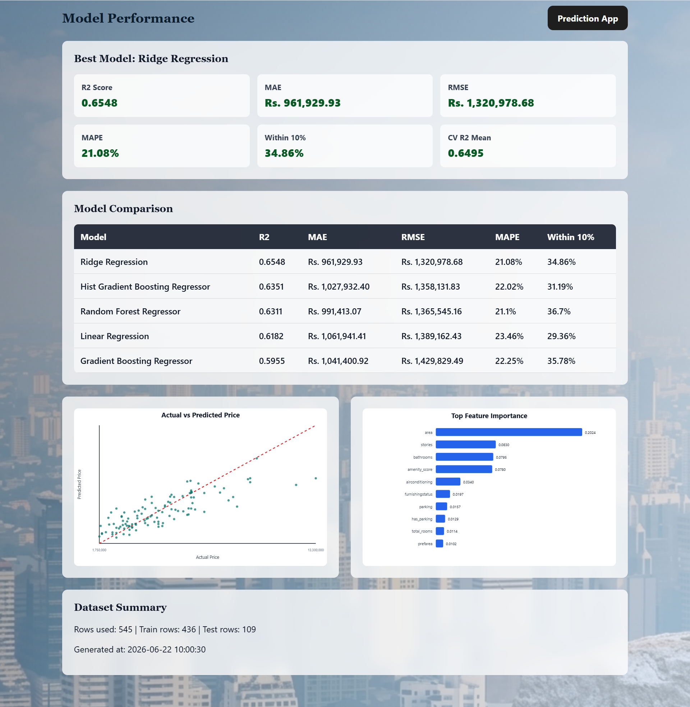
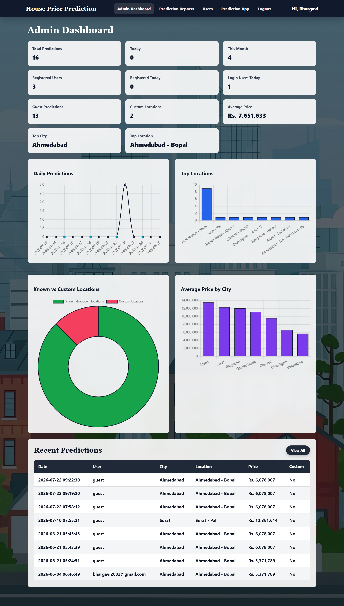

# House Price Prediction Web Application

An end-to-end full-stack Machine Learning web application that predicts house prices using property details, location, amenities, furnishing status, and engineered features.

The project includes model training, model comparison, prediction history, user authentication, admin analytics, CSV export, CSRF-protected admin actions, SQLite for local development, and PostgreSQL support for production deployment.

---

## Features

- Real-time house price prediction using a trained Scikit-learn model
- Known-location dropdown and custom unseen-location support
- Guest prediction without login
- User registration and login
- Registered user prediction history
- Admin dashboard with daily, monthly, guest, user, and custom-location analytics
- Prediction logs with filters, actions, delete option, and CSV export
- Role-based access control: Guest, Registered User, Admin
- Model metrics dashboard with R2, MAE, RMSE, MAPE, and comparison table
- Actual vs Predicted chart
- Feature importance chart
- JSON API endpoint for prediction
- CSRF protection for admin delete buttons
- SQLite support for local development
- PostgreSQL support for Render or other production hosting

---

## Tech Stack

- Python
- Flask
- Scikit-learn
- Pandas
- NumPy
- Joblib
- SQLite
- PostgreSQL
- HTML
- CSS
- JavaScript
- Gunicorn

---

## Project Structure

```text
HousePricePrediction/
|
|-- app.py
|-- train_model.py
|-- requirements.txt
|-- Procfile
|-- README.md
|-- .gitignore
|-- model.pkl
|-- metrics.json
|-- house_prices_data.csv
|
|-- templates/
|   |-- index.html
|   |-- login.html
|   |-- register.html
|   |-- history.html
|   |-- metrics.html
|   |-- admin_dashboard.html
|   |-- admin_predictions.html
|   |-- admin_users.html
|
|-- static/
|   |-- style.css
|   |-- bg1.png
|   |-- background.jpg
|   |-- charts/
|   |   |-- actual_vs_predicted.svg
|   |   |-- feature_importance.svg
|   |
|   |-- screenshots/
|       |-- prediction-page.png
|       |-- metrics-page.png
|       |-- admin-dashboard.png
|       |-- prediction-logs.png
```

---

## Installation and Setup

### 1. Clone the repository

```bash
git clone https://github.com/YOUR_USERNAME/HousePricePrediction.git
cd HousePricePrediction
```

### 2. Create a virtual environment

```bash
python -m venv venv
```

### 3. Activate the virtual environment

Windows:

```bash
venv\Scripts\activate
```

Mac/Linux:

```bash
source venv/bin/activate
```

### 4. Install dependencies

```bash
pip install -r requirements.txt
```

### 5. Train the model

```bash
python train_model.py
```

This generates:

```text
model.pkl
metrics.json
static/charts/actual_vs_predicted.svg
static/charts/feature_importance.svg
```

### 6. Run the application

```bash
python app.py
```

Open your browser:

```text
http://127.0.0.1:5000/
```

---

## Default Admin Login

When the app runs for the first time, it creates a default admin account:

```text
Email: admin@example.com
Password: admin123
```

For deployment, change these using environment variables:

```text
ADMIN_EMAIL
ADMIN_PASSWORD
SECRET_KEY
```

Do not upload your private local database file to GitHub.

---

## User Roles

### Guest

- Predict house price
- Activity is saved as guest prediction in admin logs

### Registered User

- Predict house price
- View own prediction history

### Admin

- View admin dashboard
- View prediction logs
- Export prediction logs as CSV
- Delete prediction records
- View registered users
- Track daily registered users, logged-in users, and predictions

---

## Model Information

Current best model:

```text
Ridge Regression
```

Current model performance:

```text
R2 Score: 0.6548
MAE: Rs. 961,929.93
RMSE: Rs. 1,320,978.68
MAPE: 21.08%
Accuracy within 10% error: 34.86%
Accuracy within 20% error: 58.72%
Cross-validation R2: 0.6495 +/- 0.0453
```

Models compared:

- Ridge Regression
- Linear Regression
- Random Forest Regressor
- Gradient Boosting Regressor
- Hist Gradient Boosting Regressor

Feature engineering used:

- Total rooms
- Area per bedroom
- Area per room
- Amenity score
- Parking availability
- City encoding
- Location encoding

---

## Model Metrics Dashboard

Open:

```text
http://127.0.0.1:5000/metrics
```

The metrics dashboard displays:

- R2 score
- MAE
- RMSE
- MAPE
- Cross-validation score
- Model comparison table
- Actual vs Predicted chart
- Feature importance chart

---

## Admin Dashboard

Open:

```text
http://127.0.0.1:5000/admin/dashboard
```

The admin dashboard tracks:

- Total predictions
- Predictions today
- Predictions this month
- Registered users
- Registered users today
- Logged-in users today
- Guest predictions
- Custom location searches
- Average predicted price
- Most searched city
- Most searched location

---

## Screenshots

Save project screenshots in:

```text
static/screenshots/
```

Recommended screenshot files:

```text
prediction-page.png
metrics-page.png
admin-dashboard.png
prediction-logs.png
```

Add these images before final GitHub upload:








---

## API Usage

Endpoint:

```text
POST /api/predict
```

Example request:

```json
{
  "location": "Ahmedabad - Bopal",
  "area": 1500,
  "bedrooms": 3,
  "bathrooms": 2,
  "stories": 2,
  "mainroad": "yes",
  "guestroom": "no",
  "basement": "no",
  "hotwaterheating": "no",
  "airconditioning": "yes",
  "parking": 1,
  "prefarea": "yes",
  "furnishingstatus": "semi-furnished"
}
```

Example response:

```json
{
  "prediction": 5371789.25,
  "formatted_prediction": "Rs. 5,371,789.25",
  "city": "Ahmedabad",
  "location": "Ahmedabad - Bopal",
  "is_custom_location": false,
  "warning": null,
  "model": "Ridge Regression"
}
```

---

## Security Features

- Passwords are stored using secure password hashing.
- Admin delete actions use CSRF tokens.
- Raw IP addresses are not stored; hashed IP values are saved for privacy-aware analytics.
- Admin-only routes are protected using role-based permission checks.
- Secret values should be configured using environment variables in production.

---

## Local Database

The app uses SQLite locally by default:

```text
house_price_app.db
```

This file is automatically created when you run the app. It is ignored by Git and should not be uploaded.

Each person who downloads the project from GitHub will get a fresh local database on their own system.

---

## PostgreSQL Production Support

For production deployment, set this environment variable:

```text
DATABASE_URL
```

If `DATABASE_URL` starts with `postgres://` or `postgresql://`, the app automatically uses PostgreSQL.

If `DATABASE_URL` is not set, the app uses local SQLite.

---

## Render Deployment

### 1. Push this project to GitHub

Upload these files and folders:

```text
app.py
train_model.py
requirements.txt
Procfile
README.md
.gitignore
model.pkl
metrics.json
house_prices_data.csv
templates/
static/
```

Do not upload:

```text
venv/
__pycache__/
house_price_app.db
.env
instance/
```

### 2. Create a Render web service

In Render:

```text
New + -> Web Service
Connect GitHub repository
Environment: Python
Build Command: pip install -r requirements.txt
Start Command: gunicorn app:app
```

### 3. Add environment variables

```text
SECRET_KEY=<generate-a-secure-random-secret>
ADMIN_EMAIL=admin@example.com
ADMIN_PASSWORD=admin123
```

For production database:

```text
DATABASE_URL=<your-render-postgresql-internal-database-url>
```

### 4. Optional: Add Render PostgreSQL

Create a PostgreSQL database in Render and copy its internal database URL into the web service environment variable:

```text
DATABASE_URL
```

After deployment, your app will have a public URL like:

```text
https://house-price-prediction.onrender.com
```

---

## GitHub Upload Commands

```bash
git init
git add app.py train_model.py requirements.txt Procfile README.md .gitignore model.pkl metrics.json house_prices_data.csv templates static
git commit -m "Complete full-stack house price prediction app"
git branch -M main
git remote add origin https://github.com/YOUR_USERNAME/HousePricePrediction.git
git push -u origin main
```

If the remote already exists:

```bash
git remote set-url origin https://github.com/YOUR_USERNAME/HousePricePrediction.git
git push -u origin main
```

---

## Suggested GitHub Repository Description

```text
Full-stack ML house price prediction web app with Flask, Scikit-learn, authentication, admin analytics dashboard, prediction logging, model metrics, CSV export, CSRF protection, SQLite/PostgreSQL support, and Render deployment configuration.
```

---

## Notes

- This is a regression ML project, so R2, MAE, RMSE, and MAPE are more suitable than precision and recall.
- Optional UI fields such as elevator, subway access, kitchen count, and drawing room are currently logged for analytics but are not part of the trained model unless added to the dataset and retrained.
- The current model is good for a student-level full-stack ML project, but production real-estate systems need larger datasets, geospatial features, and continuous model monitoring.

---

## Resume Highlight

```text
Developed a full-stack house price prediction web application using Flask and Scikit-learn with feature engineering, model comparison, user authentication, RBAC, prediction history, admin analytics dashboard, CSV export, CSRF-protected admin actions, API support, and cloud deployment readiness with SQLite/PostgreSQL support.
```
